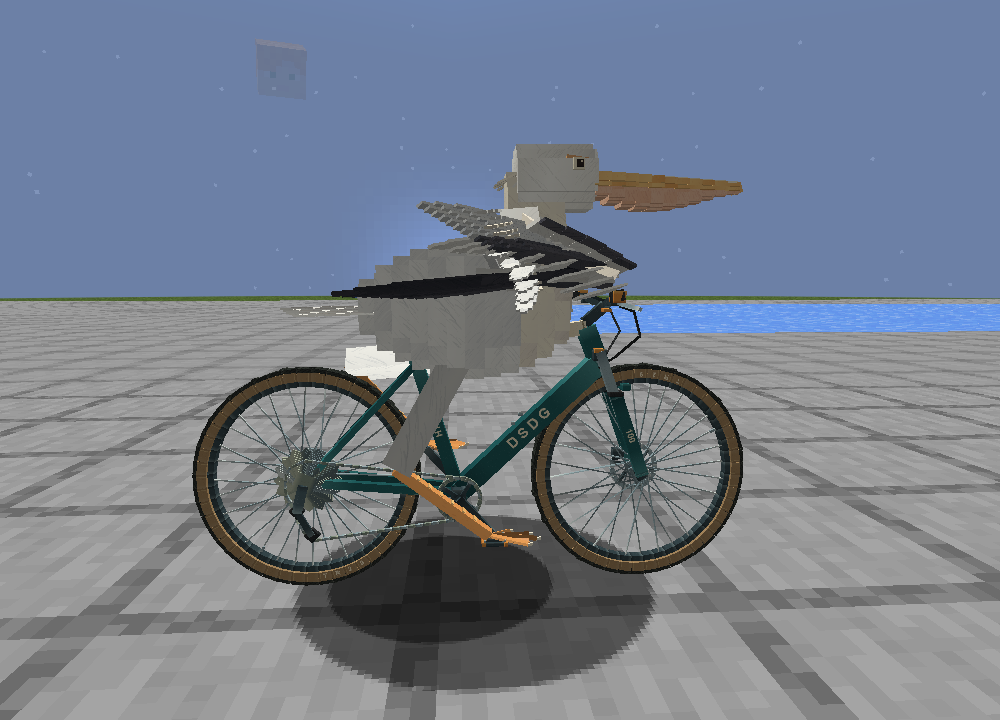

# pelican_and_bike

一个独立的 Minecraft Fabric 模组。美洲鹈鹕能走到 29 寸硬尾山地车旁，自己登车、踩踏、转弯和制动。玩家也能骑同一辆车。附近有浅水和鱼时，可以看到鹈鹕停在岸边、下水围鱼和结伴滑翔。



## 安装

使用 **Minecraft Java 版 1.20.1、Java 17 和 Fabric Loader 0.16.14 或更高版本**。把本模组、对应 1.20.1 的 Fabric API 和 GeckoLib 4 放入游戏的 `mods` 文件夹。多人联机时，服务端和每个客户端都需要安装。验证所用的依赖版本为 Fabric API 0.92.5 和 GeckoLib 4.2.4。[下载发行版](https://github.com/OBdangshang07/pelican_and_bike/releases/latest)

## 试玩

1. 在创造模式的「工具与实用物品」中拿到山地车，右击平地放车。
2. 在「刷怪蛋」中找到美洲鹈鹕，也可以输入下列命令。把鹈鹕放在空车八格以内，给踏板两侧和头顶留出空间。
3. 右击直立的空车可上车。潜行右击可推车或松手；车倒地后，待它停稳，再右击扶起。

```mcfunction
/give @s pelican_and_bike:bicycle
/give @s pelican_and_bike:pelican_spawn_egg
/summon pelican_and_bike:pelican ~ ~ ~
```

| 默认按键 | 骑行操作 |
|---|---|
| W / 松开 W | 踩踏 / 滑行 |
| A、D | 转向 |
| S | 前后轮同时制动 |
| R、F | 分别使用前刹、后刹 |
| [、] | 降挡、升挡 |
| 左 Ctrl | 站立踩踏 |
| X、C | 重心后移、前移 |

湿地和冰面会延长刹车距离。持续侧滑或正面高速撞击可能摔车。两只鹈鹕各有一辆车时可以跟骑，在浅水中也会协作捕鱼。自然生成区域为河流和沼泽的开阔岸边。自行车专用按键可在「选项 → 控制 → 按键绑定」中调整。

## 源码和模型

使用 JDK 17 运行 `./gradlew build`，Windows 下运行 `.\gradlew.bat build`。构建产物位于 `build/libs/`。测试涵盖车辆动力学、玩家骑姿及鹈鹕脚蹼和翼腕的接触位置。[自行车 Blockbench 工程](art/bicycle.bbmodel) · [骑手工程](art/bicycle_rider.bbmodel) · [鹈鹕工程](art/pelican.bbmodel)

本项目沿用原项目的 CC0 1.0 许可。[许可证](LICENSE)
